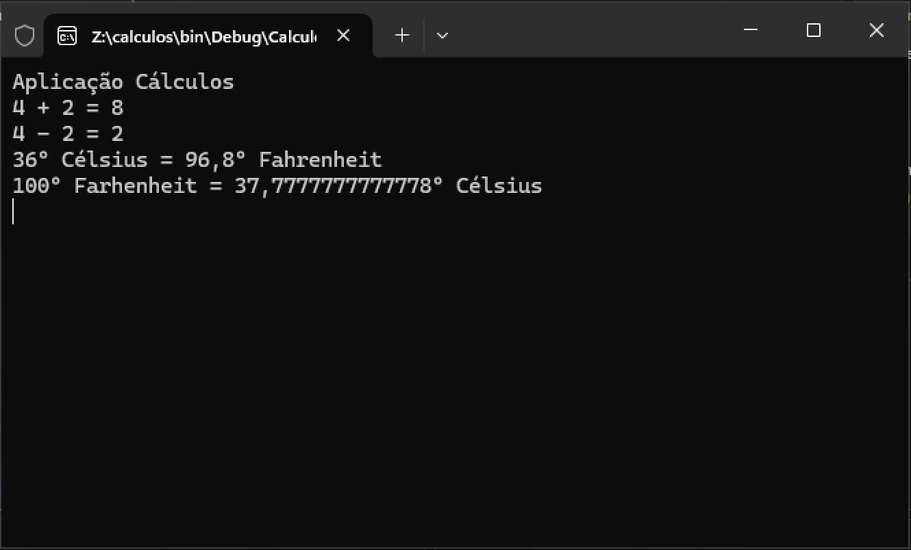

# calculos :1234:

Aplicação C# para efetuar diversos tipos de cálculos.

Desenvolvida no âmbito da ação de formação **_Introdução ao Git e GitHub_**.

## Operações suportadas

Neste momento esta aplicação implementa as seguintes operações:

- Operações aritméticas
    - soma
    - subtração
    - multiplicação
- Conversão de temperaturas
    - Célsius :arrow_right: Fahrenheit
    - Fahrenheit :arrow_right: Célsius
- Conversão de distâncias
    - Metros :arrow_right: Milhas
    - Milhas :arrow_right: Metros

## Tecnologias utilizadas neste projecto

- **Visual Studio**
- C#
- Git
- GitHub Desktop
- Plataforma GitHub

## Site oficial

Não possui nenhum site oficial.